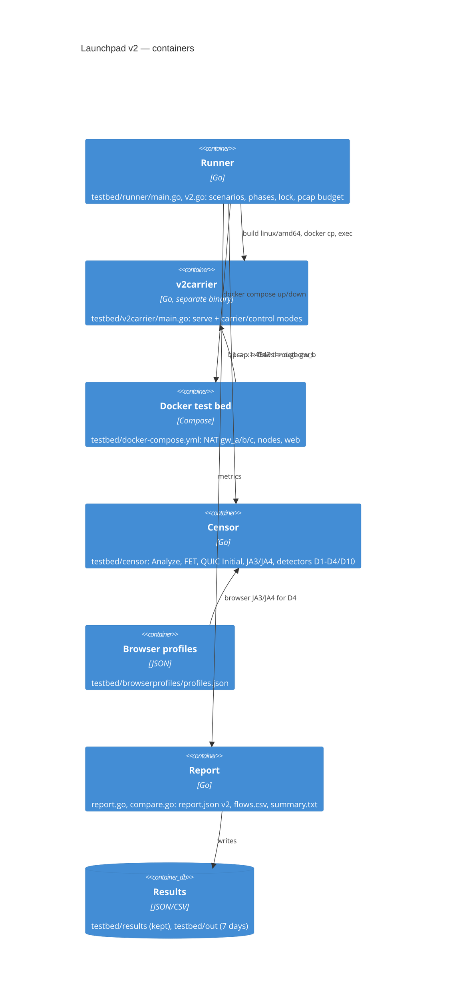

# Launchpad v2 (T15.0a)

One entry point for the v2 protocol: a scenario selects phases, a phase produces metrics, and one
run writes one directory. It reuses the v1 test bed's Docker network, `testbed/censor`, `ndpigen`
and the NAT routers; the v1 scenarios are unchanged.

```
go run ./testbed/runner -scenario v2-basic
go run ./testbed/runner -scenario v2-censor -pcap -pcap-budget 64MB -seed 42
go run ./testbed/runner compare testbed/results/<a>.json testbed/results/<b>.json
```

## Scenarios and phases

| Scenario | Default phases | What it does |
|---|---|---|
| `v2-basic` | `echo` | two `efv2` nodes on the WAN; 1 GiB through the echo stream over real noise3, 100 datagrams, the server's `efv2 status` |
| `v2-censor` | `censor` | captures the b network, drives the v2 carrier harness and the browser control, runs D1–D4/D10 |
| `v2-carrier` | `censor` | the same capture/harness path, for a carrier-only run |

`-phases censor,net,services,echo` overrides the default. Other flags: `-seed`, `-profile
desktop|android`, `-network lab|ru-mobile|cn|ir`, `-v2-echo-bytes` (default 1 GiB), `-pcap`,
`-pcap-budget` (default and maximum
2GB), `-lock` (default `testbed/.testbed.lock`). The budget is enforced in the writer: the capture
stops at the limit, never a poll interval later. The runner refuses to start without a valid pcap
budget, and holds the run lock for the whole run. The coordinator's `locks/testbed.lock` is a
separate, human-level lock: one run per machine.

## Report

`testbed/out/<time>-<scenario>/` gets:

- `report.json` — schema 2: `when`, `commit`, `spec` (`v2@<hash of docs/protocol/v2>`), `profile`,
  `scenario`, `seed`, `network`, `phases`, `detectors` (recall/FPR/n per D; `recall` is `null` when
  the run had no positive control), `aggregate` (visibility), `coverage`, `behaviour`, `resources`,
  `carrier`, `browser_profiles`, `pcap`, `flows`, `findings`;
- `flows.csv` — the top 200 flows: proto, client, server, suite, service, bytes, duration,
  first size, label, looks, SNI, JA3/JA4, verdict and per-detector scores;
- `summary.txt` — the one-page human report; container logs and their analysis are in
  `logs-summary.txt` and `*.log`;
- `wan-*.pcap` — only for a red run with `-pcap`; a green analysis deletes it. Without `-pcap`
  no pcap file is created at all: `tcpdump -w -` streams into the runner, the detectors read it
  from memory, and the bytes are dropped after the analysis.

`testbed/results/<time>-<commit>-<profile>.json` is the copy `compare` reads; it lives outside
`testbed/out`, which is pruned after seven days. `testbed/results/` is git-ignored.

`compare` prints two columns and marks every changed metric with `*`, then both runs' findings.

## Detectors (M1)

| ID | Rule | Files |
|---|---|---|
| D1 | GFW FET on the first TCP payload | `censor/hello.go` (`fullyEncrypted`) |
| D2 | QUIC Initial SNI against a block list | `censor/quic.go`, `censor/detectors.go` |
| D3 | SNI against the address/ASN it resolves to | `censor/analyze.go` (`CheckSNI`), `censor/detectors.go` |
| D4 | JA3/JA4 and ClientHello shape against Chrome | `censor/hello.go`, `censor/fingerprint.go` |
| D10 | UDP shape: QUIC v1 fingerprint, entropy, 25-packet count | `censor/analyze.go`, `censor/detectors.go` |

A detector never sees the label. `EvaluateDetectors` counts recall on the controls the scenario
labelled (D2: the `quic-go` flow, D3: `tls-go`/`quic-go`, not the rule's own output) and FPR on the
browser flows only; the gate is FPR ≤ 1 %. With no positive control the recall is `null`
("unavailable"), never 1, and `coverage` says so.

## Browser profiles

`testbed/browserprofiles/profiles.json` (version `2026.11.1`) holds captures per country/network:
a real Chrome when it is installed, otherwise the uTLS Chrome preset, plus `curl`, `crypto/tls`
and `quic-go` — each entry says which source and version it is. Refresh:

```
go run ./testbed/browserprofiles/cmd/capture -country lab -network lab
```

T2.6d uses the same file as a regression: a carrier whose hello drifts away from the Chrome family
is a finding. Real country/network captures belong to the field work (T15.2).

## v2 carrier harness

`testbed/v2carrier` is a separate binary and process. The runner builds it for linux/amd64, copies
it into the lab nodes, starts `-mode serve` on `x1:4343`, and runs one mode at a time from `b1`:

| Mode | Label | Purpose |
|---|---|---|
| `udp-noise` | carrier, synthetic | noise3-shaped UDP; `carrier/noise3` is merged (T2.4) and `v2-basic` exercises it, but this harness mode is still a synthetic stand-in with the same wire shape |
| `tcp-random` | carrier, synthetic | D1 control: the fully-encrypted first payload |
| `tls-go` | tool | `crypto/tls`: no GREASE, a library fingerprint |
| `tls-chrome` | browser | uTLS Chrome preset |
| `quic-go` | tool | real QUIC with a blocked SNI |
| `quic-chrome` | browser | quic-go ChromeParrot, the browser-like QUIC control |

The pcap is taken at `gw_b`, so the carrier, the browser control and the v1 product flow
(`b2` through `x1`) are all seen in the same network. When the real carrier lands, only the body of
`udp-noise` changes; capture, budget, labels and detectors stay.

## Scenarios (T15.1)

Seven scenarios, each in two modes. The **model** mode runs the product's own code (`internal/v2`: real
nodes, real noise3 on loopback, the punch engine, the exit client and server, the call transport, the
access manager) against a model of the network (an in-process netem, a NAT model) and of the censor
(`testbed/censor`, `testbed/probe`), in one process and without containers. The **live** mode is the
same scenario on the Docker stand.

| Scenario | Model: what it measures | Live: what it needs |
|---|---|---|
| `v2-nat` | the punch engines against four NAT types: direct where the physics allows, relay where not, no port spray | gw_a/gw_b/gw_c, `v2r`, `v2na`..`v2nc` |
| `v2-paths` | a second path, a cut with failover, an address change, H15 backoff (D24), two carriers per pair (D21) | `v2pa`, `v2pb`, a cut on gw_b |
| `v2-hidden` | no public card, the invitation opens the node, a stranger gets silence, a revoked pass does not open | `v2h`, `v2ha`, `v2hb` |
| `v2-messaging` | chat/2 over a lossy path (delivery rows are *not measured* while the DHT of the loopback world does not resolve) | `v2ma`, `v2mb`, `v2mx` |
| `v2-call` | voice and video frames under 5 % loss and a 150 ms round trip, on the direct path | `v2ca`, `v2cc`, the NAT routers |
| `v2-exit` | a download through the exit, SSRF refusal, failover to a second exit, resources | `v2xe`, `v2xc`, `web` |
| `v2-censor` | four carriers against the censor model and the active prober | `x1`, `web`, gw_b |

```
go run ./testbed/scenarios/cmd/launchpad-scenarios -list
go run ./testbed/scenarios/cmd/launchpad-scenarios -scenario v2-nat            # three runs in a row
go run ./testbed/scenarios/cmd/launchpad-scenarios -out reports/scenarios      # all seven
go run ./testbed/gate/cmd/launchpad-gate -report ... -scenarios reports/scenarios/scenarios.json
go run ./testbed/runner -scenario v2-nat                                       # the live entry
```

`launchpad-scenarios` exits 0 when every row is green over the runs, 1 on a red row (the series stops at the
first red run), 2 when something was not measured (`-allow-unmeasured` accepts a partial run), 3 on bad
arguments. It writes `scenarios.json`, which `launchpad-gate -scenarios` reads: the model rows are judged
with the gate's own limits, and the live stand is *not measured* until it has been run.

The live entry (`runner -scenario v2-nat` and the other five) starts nothing today and exits 4: the compose
services (profile `v2`, so the v1 scenarios' `up -d` leaves them alone) and the `efv2` role of the
entrypoint (`EFV2_MODE=serve|idle`) are ready and checked statically (`docker compose config`, shellcheck,
`scenarios/live_test.go`), but the efv2 CLI has no command yet for chat, calls, the exit, hidden access or a
second path. `scenarios/live.go` lists what each scenario needs. Three green live runs in a row are the
work of the audit phase.

## Containers (C4, actual code)



## What is still open

- `v2-censor` still drives the synthetic `udp-noise` harness mode: the real `carrier/noise3` is
  exercised by `v2-basic` (and `carrier/reality2-quic` joins it when T2.6b lands).
- D5–D9 and the active/behavioral detectors are T15.0b/T15.0c.
- Real Chrome captures for RU/IR/CN networks are field work (T15.2); the lab file is honest about
  which source produced each entry.
