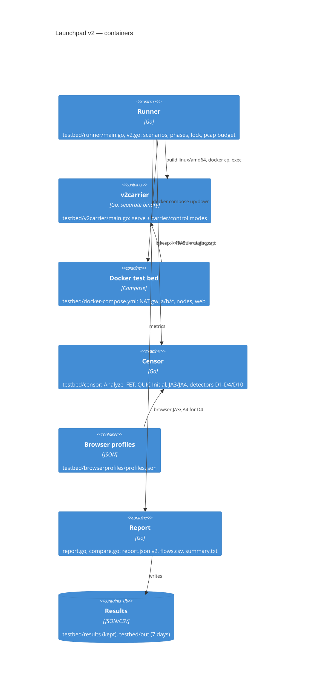

# Launchpad v2 (T15.0a)

One entry point for the v2 protocol: a scenario selects phases, a phase produces metrics, and one
run writes one directory. It reuses the v1 test bed's Docker network, `testbed/censor`, `ndpigen`
and the NAT routers; the v1 scenarios are unchanged.

```
go run ./testbed/runner -scenario v2-basic
go run ./testbed/runner -scenario v2-censor -pcap -pcap-budget 64MB -seed 42
go run ./testbed/runner compare testbed/results/<a>.json testbed/results/<b>.json
```

## Scenarios and phases

| Scenario | Default phases | What it does |
|---|---|---|
| `v2-basic` | `net,services` | the lab mesh forms; a few messages are delivered exactly once (v1 product until `efv2` exists) |
| `v2-censor` | `censor` | captures the b network, drives the v2 carrier harness and the browser control, runs D1–D4/D10 |
| `v2-carrier` | `censor` | the same capture/harness path, for a carrier-only run |

`-phases censor,net,services` overrides the default. Other flags: `-seed`, `-profile
desktop|android`, `-network lab|ru-mobile|cn|ir`, `-pcap`, `-pcap-budget` (default and maximum
2GB), `-lock` (default `testbed/.testbed.lock`). The runner refuses to start without a valid pcap
budget, and holds the run lock for the whole run. The coordinator's `locks/testbed.lock` is a
separate, human-level lock: one run per machine.

## Report

`testbed/out/<time>-<scenario>/` gets:

- `report.json` — schema 2: `when`, `commit`, `spec`, `profile`, `scenario`, `seed`, `network`,
  `phases`, `detectors` (recall/FPR/n per D), `aggregate` (visibility), `coverage`, `behaviour`,
  `resources`, `carrier`, `browser_profiles`, `pcap`, `flows`, `findings`;
- `flows.csv` — the top 200 flows: proto, client, server, suite, service, bytes, duration,
  first size, label, looks, SNI, JA3/JA4, verdict and per-detector scores;
- `summary.txt` — the one-page human report; container logs and their analysis are in
  `logs-summary.txt` and `*.log`;
- `wan-*.pcap` — only for a red run with `-pcap`; a green analysis deletes it.

`testbed/results/<time>-<commit>-<profile>.json` is the copy `compare` reads; it lives outside
`testbed/out`, which is pruned after seven days. `testbed/results/` is git-ignored.

`compare` prints two columns and marks every changed metric with `*`, then both runs' findings.

## Detectors (M1)

| ID | Rule | Files |
|---|---|---|
| D1 | GFW FET on the first TCP payload | `censor/hello.go` (`fullyEncrypted`) |
| D2 | QUIC Initial SNI against a block list | `censor/quic.go`, `censor/detectors.go` |
| D3 | SNI against the address/ASN it resolves to | `censor/analyze.go` (`CheckSNI`), `censor/detectors.go` |
| D4 | JA3/JA4 and ClientHello shape against Chrome | `censor/hello.go`, `censor/fingerprint.go` |
| D10 | UDP shape: QUIC v1 fingerprint, entropy, 25-packet count | `censor/analyze.go`, `censor/detectors.go` |

A detector never sees the label. `EvaluateDetectors` counts recall on the controls it should catch
and FPR on the browser flows only; the gate is FPR ≤ 1 %.

## Browser profiles

`testbed/browserprofiles/profiles.json` (version `2026.11.1`) holds captures per country/network:
a real Chrome when it is installed, otherwise the uTLS Chrome preset, plus `curl`, `crypto/tls`
and `quic-go` — each entry says which source and version it is. Refresh:

```
go run ./testbed/browserprofiles/cmd/capture -country lab -network lab
```

T2.6d uses the same file as a regression: a carrier whose hello drifts away from the Chrome family
is a finding. Real country/network captures belong to the field work (T15.2).

## v2 carrier harness

`testbed/v2carrier` is a separate binary and process. The runner builds it for linux/amd64, copies
it into the lab nodes, starts `-mode serve` on `x1:4343`, and runs one mode at a time from `b1`:

| Mode | Label | Purpose |
|---|---|---|
| `udp-noise` | carrier, synthetic | noise3-shaped UDP; **the real `carrier/noise3` is not merged in v2 yet (T2.4), and `efv2` is not built (T0.3)** |
| `tcp-random` | carrier, synthetic | D1 control: the fully-encrypted first payload |
| `tls-go` | tool | `crypto/tls`: no GREASE, a library fingerprint |
| `tls-chrome` | browser | uTLS Chrome preset |
| `quic-go` | tool | real QUIC with a blocked SNI |
| `quic-chrome` | browser | quic-go ChromeParrot, the browser-like QUIC control |

The pcap is taken at `gw_b`, so the carrier, the browser control and the v1 product flow
(`b2` through `x1`) are all seen in the same network. When the real carrier lands, only the body of
`udp-noise` changes; capture, budget, labels and detectors stay.

## Containers (C4, actual code)



## What is still open

- `efv2` (T0.3) and `carrier/noise3` (T2.4) are not in `v2`; this run is synthetic plus the v1
  product, and the report says so in `findings`.
- D5–D9 and the active/behavioral detectors are T15.0b/T15.0c.
- Real Chrome captures for RU/IR/CN networks are field work (T15.2); the lab file is honest about
  which source produced each entry.
